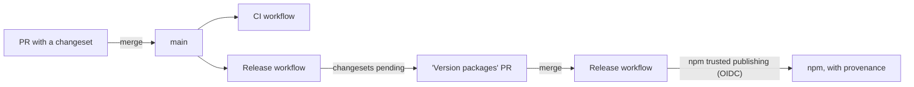

# CI, releases and npm publishing

How code gets from a PR to npm for `@gamebeast/core`, `@gamebeast/js` and `@gamebeast/node`, and
how that setup is wired on GitHub and npmjs.com. Read this before changing a workflow, adding a
package, or debugging a failed release.

## Overview



| Workflow                                          | Runs on                      | Does                                                                                        |
| ------------------------------------------------- | ---------------------------- | ------------------------------------------------------------------------------------------- |
| [`ci.yml`](../.github/workflows/ci.yml)           | every PR, every push to main | `typecheck`, `lint`, `format:check`, `test`, `build`, `check:package` on Node 20, 22 and 24 |
| [`release.yml`](../.github/workflows/release.yml) | every push to main           | Opens/updates the "Version packages" PR, or publishes versions that aren't on npm yet       |

## Releasing a change

1. In your PR, run `npm run changeset`. Pick the bump (patch / minor / major) and write the
   changelog entry. Commit the generated `.changeset/*.md` file with the change.
2. Merge the PR. The Release workflow opens (or updates) a **"chore: version packages"** PR that
   bumps the versions, updates each package's `CHANGELOG.md`, and refreshes `package-lock.json`.
3. Merge the "Version packages" PR. The Release workflow runs every check again, then
   `changeset publish` publishes each package whose version isn't on npm yet, pushes git tags, and
   creates GitHub releases.

The three packages are a Changesets `fixed` group (`.changeset/config.json`): they always release
together with one version, even when only one of them changed. `@gamebeast/js` and
`@gamebeast/node` pin `@gamebeast/core` to that exact version, and Changesets rewrites the pins
when it bumps. `@gamebeast/test-utils` is private and never versioned or published.

A merge with no changeset publishes nothing: the versions in `package.json` are already on npm, so
`changeset publish` finds nothing to do.

### Choosing a bump

The SDKs are public API, so follow semver strictly: a **major** for any breaking change to an
exported name, option or behavior; a **minor** for additions; a **patch** for fixes. `@gamebeast/core`
has no semver promise for direct users, but it shares the group's version anyway.

## Updating the API contract

Request and response shapes come from
[`@gamebeast/sdk-contract`](https://www.npmjs.com/package/@gamebeast/sdk-contract), which lives in
`GamebeastGG/service-monorepo` (`packages/sdk-contract`) and is published from there by its own
`publish-sdk-contract.yml`. Its README covers releasing it. To pick up a new contract version:

1. Release the contract from service-monorepo (bump its `version`, merge).
2. Here, bump `@gamebeast/sdk-contract` in `packages/core/package.json` and
   `packages/node/package.json`, run `npm install`, and add a changeset.

## npm and GitHub setup

Publishing uses [npm trusted publishing](https://docs.npmjs.com/trusted-publishers): npm accepts an
OIDC token from this repo's Release workflow, so there is **no npm token secret**. Provenance
attestations come from the same token (`NPM_CONFIG_PROVENANCE`, `id-token: write`).

Each package has this trusted publisher on npmjs.com (package **Settings → Trusted publishing**):

| Field       | Value                      |
| ----------- | -------------------------- |
| Provider    | GitHub Actions             |
| Repository  | `GamebeastGG/gamebeast-js` |
| Workflow    | `release.yml`              |
| Environment | `npm-publish`              |
| Permissions | `publish`                  |

Check an entry with `npm trust list @gamebeast/<name>`. The Release job runs in the `npm-publish`
GitHub environment, and the workflow needs Node 24 (npm ≥ 11.5 is required for trusted publishing).
On GitHub, **Settings → Actions → General → Workflow permissions** must allow GitHub Actions to
create pull requests; that is how the "Version packages" PR gets opened.

Renaming `release.yml`, the `npm-publish` environment, or the repository breaks publishing until
every package's trusted publisher is updated to match.

### Adding a new published package

Trusted publishing can only publish new versions of a package that already exists, so a new
package needs a one-time bootstrap:

1. Publish a placeholder from your machine to create it on npm:

   ```sh
   mkdir /tmp/placeholder && cd /tmp/placeholder
   echo '{ "name": "@gamebeast/<name>", "version": "0.0.0-placeholder", "license": "Apache-2.0" }' > package.json
   npm publish --access public --tag placeholder
   ```

2. Add the trusted publisher, with publish permission:

   ```sh
   npm trust github @gamebeast/<name> --file release.yml --repo GamebeastGG/gamebeast-js \
     --env npm-publish --allow-publish -y
   ```

3. Add the package to the `fixed` group in `.changeset/config.json` and to the root `workspaces`.
4. Once the first real version is out, deprecate the placeholder:
   `npm deprecate @gamebeast/<name>@0.0.0-placeholder "Placeholder. Use >= 1.0.0"`.

Commands that change npm settings or publish from your machine need 2FA. With a security key, npm
prints a link to approve in the browser, so run them in your own terminal.

## Troubleshooting a failed release

| Error in the Release log                                             | Cause and fix                                                                                                                                                                         |
| -------------------------------------------------------------------- | ------------------------------------------------------------------------------------------------------------------------------------------------------------------------------------- |
| `403 Forbidden ... OIDC permission denied for this action`           | The trusted publisher only has `stage publish`. Revoke it (`npm trust revoke @gamebeast/<name> --id=<id>`, id from `npm trust list`) and recreate it with `--allow-publish` as above. |
| `404 Not Found - PUT https://registry.npmjs.org/@gamebeast%2f<name>` | The package doesn't exist on npm yet. Bootstrap it with a placeholder (see [Adding a new published package](#adding-a-new-published-package)).                                        |
| `403 ... You cannot publish over the previously published versions`  | That version is already on npm. Harmless when retrying; otherwise a version bump is missing.                                                                                          |
| `npm ci` fails with `404` / `notarget` for `@gamebeast/sdk-contract` | The contract version in `package.json` isn't published. Release it from service-monorepo first.                                                                                       |

A failed publish leaves `main` unchanged, so it is safe to fix the cause on npmjs.com and rerun
the failed Release run (`gh run rerun <id>`). `changeset publish` skips versions that are already on
npm, so a partially failed run can be rerun too.

## History

- The SDKs were one package, `@gamebeast/sdk` (with `/client` and `/server` subpaths), in a repo
  called `NodeSDK`. It was never published. The repo was renamed to `gamebeast-js` and split into
  the three packages here, all released together at **1.0.0** by the Release workflow, with
  provenance.
- `@gamebeast/node` 0.1.0 is an older, unrelated SDK, superseded by 1.0.0. Deprecate it with
  `npm deprecate @gamebeast/node@"<1.0.0" "Superseded by @gamebeast/node 1.x"`.
- `@gamebeast/core` and `@gamebeast/js` `0.0.0-placeholder`, and `@gamebeast/sdk-contract`
  `0.0.0-stage`, are the placeholders that created those packages on npm. Deprecate them the same
  way.
- `@gamebeast/sdk-contract` 1.0.0 was published by hand (no provenance); later versions come from
  its workflow.
